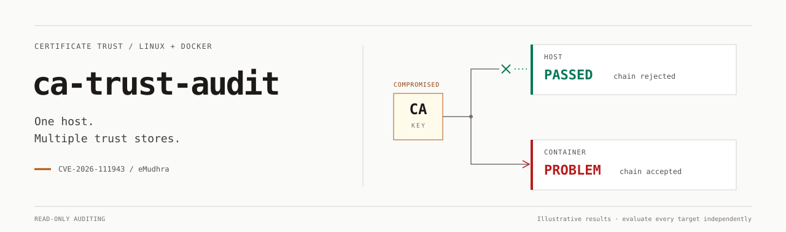

# ca-trust-audit



[](https://github.com/andersundsehr/ca-trust-audit/actions/workflows/ci.yml)
[](https://github.com/andersundsehr/ca-trust-audit/releases)

**Read-only certificate trust auditing for Linux hosts and running Docker containers.**
One standalone Go binary for **AMD64 / ARM64**, including WSL; also available as a reusable Go library.

[Install](#install-and-scan) · [Usage](#usage) · [Results](#read-the-results) · [Coverage](#coverage) · [Go API](#go-api) · [Technical reference](docs/reference.md)

## Why this needs attention

> [!IMPORTANT]
> **eMudhra intermediate CA compromise — CVE-2026-111943 (October 2026).**
> The [incident advisory](https://emudhra.we-have-a-problem.com/) reports compromised signing keys for **six TLS intermediate CAs and two code-signing CAs**, including cross-signed chains.
> Systems that still accept an affected TLS chain may trust **attacker-issued HTTPS certificates**.

| Risk | Why act promptly? |
| --- | --- |
| **HTTPS impersonation / MITM** | An attacker able to intercept or redirect traffic could impersonate services, steal credentials/session tokens, or read and alter traffic. |
| **Fresh fraudulent certificates** | A compromised CA key can sign new certificates. Renewing your own website certificate does not remove that trust. |
| **Stale container or application bundles** | Updating the host does not replace CA bundles baked into existing images. PHP, curl, Python/certifi and Node.js can use different trust sources. |

**Recommended response:**

1. **Audit** the host, running containers, and relevant runtime clients.
2. **Apply vendor guidance:** distrust/runtime updates, replacement of stale CA bundles, and rebuilding/redeploying affected images.
3. **Rescan** and resolve incomplete coverage before treating an application as protected.

**Incident keywords:** CVE-2026-111943 · eMudhra · emSign · Sectigo cross-signing · compromised CA · intermediate CA · TLS/SSL certificate validation · trust store audit · Linux · Docker security.

## Install and scan

**Install the latest release with automatic AMD64/ARM64 selection:**

```sh
curl -qfsSL https://github.com/andersundsehr/ca-trust-audit/releases/latest/download/install.sh | sh
```

**Then scan the host and every running container:**

```sh
ca-trust-audit
```

| Installation | Behavior |
| --- | --- |
| Destination | `/usr/local/bin`; sudo is used only when required. |
| Installer requirements | curl and common POSIX utilities; verified HTTPS, no checksum downloads. |
| Scanner requirements | No Go, Python, OpenSSL, curl or Java installation required to run the binary. Installed clients provide optional runtime evidence. |
| Failed update | Completed downloads are staged; replacement is atomic. |

<details>
<summary><strong>Custom directory or pinned release</strong></summary>

```sh
curl -qfsSL https://github.com/andersundsehr/ca-trust-audit/releases/latest/download/install.sh | sh -s -- --install-dir "$HOME/.local/bin"
curl -qfsSL https://github.com/andersundsehr/ca-trust-audit/releases/latest/download/install.sh | sh -s -- --version v0.2.2
```

Add `$HOME/.local/bin` to `PATH` for a user-local installation. See [installer details](docs/reference.md#install) or inspect [install.sh](install.sh).

</details>

### Self-update

```sh
ca-trust-audit self-update --check    # check only
ca-trust-audit self-update            # update; use sudo if the directory requires it
ca-trust-audit self                   # short alias for self-update
```

`self` and `selfupdate` are aliases for `self-update`, with the same options (`--check`, `--force`, `--timeout`, `--color`). Suggested commands in permission errors are highlighted in cyan on terminals; `NO_COLOR`, redirection or `--color never` keep them plain. This explicit command replaces the executable; ordinary scans remain read-only. It selects the matching architecture, validates standalone Go/ELF metadata and installs atomically over verified HTTPS. No external tools or checksum file are required. [Update options and trust boundary](docs/reference.md#install).

## Usage

| Task | Command |
| --- | --- |
| Host + running containers | `ca-trust-audit` |
| Host only | `ca-trust-audit --host` (`--host-only` is equivalent) |
| Running containers only | `ca-trust-audit --containers-only` |
| One running container | `ca-trust-audit --container webapp` |
| Offline bundled-chain analysis | `ca-trust-audit --offline` |
| Additional public CA files/directories | `--ca-file /opt/app/ca.pem` / `--ca-dir /opt/app/public-cas` (repeatable) |
| Terminal + JSON file | `ca-trust-audit --json report.json` |
| JSON-only stdout | `ca-trust-audit --json -` |
| Require sufficient coverage | `ca-trust-audit --strict` |
| Detailed per-chain results | `ca-trust-audit --verbose` |

| Default / control | Meaning |
| --- | --- |
| `--workers` | Available logical CPUs (`nproc` equivalent, using Go); override with any positive integer. Bounds concurrent containers and total simultaneous TLS checks across all targets. |
| `--timeout 10s` | Per-operation deadline, range 1ms–5m; signals cancel the scan. |
| `--progress auto` | Progress on terminal stderr; `always` enables plain CI logs, `never` disables it. |
| `--color auto` | Meaningful terminal colors; `NO_COLOR`, redirection and `TERM=dumb` disable automatic colors. `always` / `never` override detection. |

**Progress:** counters and times stay first, the target stays last. Terminal redraws are limited to four per second and fitted to the terminal width.

```text
[progress] 2/4 targets processed | elapsed    18s | ETA       ~12s | checking PHP cURL | container webapp
```

**Parallel checks:** the host is scanned first, then running containers in parallel. Within each client, chain requests also run in parallel; their shared global limit is `--workers`, so a single target benefits too. Clients within a target are tested one after another, each with its own positive control.

**Conservative ETA:** uses twice the slowest completed container duration plus a 10-second buffer, worker concurrency and queued work. Before measurements, it starts with a generous budget (normally 1 minute per online target, 15 seconds offline). Long-running targets expand the estimate; it never gets stuck at `~1s`. Before Docker discovery, `target ETA` covers only the active target. Estimates can increase and are not deadlines. JSON remains free of progress and color escapes.

**Selection rules:** stopped containers are excluded. `--host` conflicts with container-only selection. CA paths refer to paths **inside each selected target**. Missing Docker leaves host results available; inaccessible Docker is reported as incomplete coverage. [All CLI semantics and limits](docs/reference.md#cli).

## Read the results

| Human result | Color | Meaning |
| --- | --- | --- |
| **PASSED** | Green | This evaluated client or CA-file model rejected the incident chains. |
| **PROBLEM** | Red | A client or explicitly evaluated store accepted a compromised chain. |
| **NOT VERIFIED** | Yellow | Evidence is incomplete: for example offline mode, a failed positive control, DNS failure or timeout. |
| **REVIEW** | Yellow | Related CA material or a policy question needs review; effective trust is unestablished. |
| **UNSUPPORTED** | Gray | This runtime or format cannot be evaluated reliably. |

> [!NOTE]
> **CA-file results and live-client results are separate.** Offline `PASSED` covers the documented PEM model; live clients remain `NOT VERIFIED`. A DNS failure never counts as a pass. TLS results do not establish code-signing safety or protection of every application.

The final summary repeats affected hosts/containers, clients and CA paths. Repeated chains are grouped; large lists show three entries plus a remaining count. For example, a **confirmed CA-file problem** can produce:

```text
SUMMARY
  Targets: 2 (hosts=1, containers=1)
  PROBLEM confirmed: clients=0, CA files=1
  PROBLEM container webapp (1234567890ab)
    CA files: /opt/app/ca.pem
  Action: update the listed runtimes/CA bundles using vendor guidance, then rerun.
  NOT VERIFIED incomplete coverage: targets=1, scan warnings=0
```

### Exit codes and JSON

| Exit | Meaning |
| --- | --- |
| **0** | No confirmed vulnerability found; warnings or partial coverage may remain. |
| **1** | Confirmed vulnerable client/store; takes precedence over strict coverage. |
| **2** | Fatal setup/options, cancellation or report I/O error. |
| **3** | `--strict` only: no confirmed vulnerability, but insufficient coverage. |

JSON uses stable **schema 1.0** with precise statuses such as `VULNERABLE_CLIENT`, `VULNERABLE_STORE` and `INCONCLUSIVE`. It includes target identity, client, chain/root, CA path, fingerprints, evidence, remediation and coverage. Report files are created with **0600** permissions and never overwritten. [Schema](docs/json-schema.md) · [Status evidence and exact exit semantics](docs/reference.md#evidence-and-threat-model).

## Coverage

| Area | Supported / limitation |
| --- | --- |
| Platforms | Linux AMD64 / ARM64, including WSL. |
| Live TLS | Go scanner stack (host only), curl, PHP OpenSSL streams + cURL, Python ssl/urllib + requests/certifi, Node.js HTTPS, Ruby HTTPS, when installed and introspection works. Each client gets an HTTPS positive control. |
| Static stores | Common Debian/Ubuntu, Alpine and RHEL/Fedora PEM layouts, selected runtime overrides and explicit CA paths. Explicit chain validation uses certificate/SPKI identities, not names alone. |
| Incident fixtures | Six TLS keys under both eMudhra and Sectigo signatures: 12 regular endpoints/chains plus two published no-CT variants, bundled and verified for offline use. |
| Minimal containers | Read-only Docker archives analyze known bundles without a shell or installed clients. No available bundle means incomplete coverage. |
| Explicitly unsupported | Java JSSE execution, JKS/PKCS#12/NSS policy evaluation, OpenSSL AUX trust attributes and full code-signing policy validation. Two affected code-signing CA keys are identified separately. |

**Important boundaries:** PEM evaluation does not reproduce every runtime's distrust, CT or revocation policy; CRLs/OCSP are not fetched automatically. CLI clients can differ from long-running application processes. Custom stores are not exhaustively discoverable.

[Runtime matrix](docs/reference.md#runtime-coverage) · [CA discovery and overrides](docs/reference.md#trust-store-discovery) · [Validation model](docs/reference.md#evidence-and-threat-model)

### Docker, distroless and running inside a container

- The native Engine API respects `DOCKER_HOST` and supported Docker contexts; no Docker CLI is needed for a local socket or explicit endpoint. [Transport/TLS limits](docs/reference.md#docker-and-minimal-containers).
- Archive reads support distroless/scratch images with a known public PEM bundle. Exec probes use direct argv, without copying helpers or installing software.
- Inside a container, its filesystem is the primary local target. For local-only operation, run `ca-trust-audit --host --offline`. Additional containers require an accessible Docker endpoint.
- **A Docker socket is powerful access**, even through a read-only bind mount; use appropriate daemon/API authorization.

**Tested PHP use case:** [`webdevops/php-apache:8.5-alpine`](docs/php85-test.md), with default-bundle checks against all 14 chains and trusted/untrusted PHP stream/cURL fixtures. Deployed overrides still need scanning as deployed.

## Security and privacy

- **Read-only scans:** no software installation, CA updates, restarts, configuration changes or disabled TLS verification.
- **Bounded access:** designated public CA files/directories only; no broad secret, private-key or application-data search. [Read/output limits](docs/reference.md#security-privacy-and-bounds).
- **Live endpoint privacy:** operators may see the requesting IP, user-agent and connection metadata. Availability, proxies and certificate rotation can prevent conclusive results. Use `--offline` when endpoint traffic is inappropriate.
- **Runtime side effects:** installed clients may execute initialization, import hooks or plugins outside the scanner's control. Static-only library use with a nil runner avoids invoking them.

## Go API

```go
r, err := audit.Scan(ctx, audit.Options{
    IncludeHost:       true,
    IncludeContainers: true,
    Timeout:           10 * time.Second,
    // Workers defaults to available logical CPUs.
})
if err != nil { /* fatal error; r may contain partial results */ }
code := r.ExitCode(true)
```

Public packages: [`audit`](pkg/audit), [`certificates`](pkg/certificates), [`docker`](pkg/docker), [`probes`](pkg/probes), [`report`](pkg/report). Zero options select host + Docker with online checks; `Offline` disables live probing. [API examples, static-only use and progress callbacks](docs/reference.md#go-api).

| Extension | Approach |
| --- | --- |
| New compromised-CA incident | Supply `Options.Incident` with pinned certificate/SPKI identities and leaf-first chains; verify provenance, signatures/hostnames and positive/negative fixtures. |
| New runtime | Implement `probes.Probe` (`Name`, `Discover`, `Check`) and pass `Options.Probes`; return normalized evidence and a pinned leaf hash on acceptance. |

[Extension guide](docs/reference.md#add-an-incident-or-runtime) · [Fixture provenance](internal/incidents/emudhra/PROVENANCE.md)

## Build, test and CI

Go **1.26+**; CI/releases pin patched **Go 1.27.3**.

```sh
go test ./...
go vet ./...
go test -race ./...
CGO_ENABLED=0 GOOS=linux GOARCH=amd64 go build -trimpath -o dist/ca-trust-audit-linux-amd64 ./cmd/ca-trust-audit
CGO_ENABLED=0 GOOS=linux GOARCH=arm64 go build -trimpath -o dist/ca-trust-audit-linux-arm64 ./cmd/ca-trust-audit
```

| Workflow | Checks / output |
| --- | --- |
| [CI](.github/workflows/ci.yml), PRs + pushes to main | Formatting, vet, unit/race tests, local TLS probes, AMD64/ARM64 builds; separate Docker/PHP integration job. Ordinary unit tests require neither Docker nor public network. |
| [Release](.github/workflows/release.yml), `v*` tags | Validate/test, build standalone binaries with reproducible metadata, publish binaries, installer, checksums and release notes. Only publishing has `contents: write`. |

<details>
<summary><strong>Optional Docker, PHP and network integration tests</strong></summary>

```sh
CA_TRUST_AUDIT_RUNTIME_TESTS=1 go test -v ./pkg/probes -run TestInstalledRuntimeTLS
CA_TRUST_AUDIT_DOCKER_TESTS=1 go test -v ./pkg/audit -run TestRealDockerShellless
docker pull webdevops/php-apache:8.5-alpine
CA_TRUST_AUDIT_PHP_IMAGE_TESTS=1 go test -v ./pkg/probes -run TestPHP85Image
CA_TRUST_AUDIT_PHP_IMAGE_TESTS=1 go test -v ./pkg/audit -run TestPHP85ParallelChains
CA_TRUST_AUDIT_PHP_IMAGE_TESTS=1 go test -v ./cmd/ca-trust-audit -run TestPHP85CLI
# Explicit third-party network suite; discloses connection metadata:
CA_TRUST_AUDIT_NETWORK_TESTS=1 go test -v ./pkg/probes -run TestPublishedEndpoints
```

Optional suites explicitly skip unless enabled; missing runtimes/modules are reported as skipped. Enabled public-network checks fail on inconclusive results. [Complete test instructions](docs/reference.md#build-and-test).

</details>

[Technical reference](docs/reference.md) · [JSON schema](docs/json-schema.md) · [PHP test evidence](docs/php85-test.md) · [Changelog](CHANGELOG.md) · [MIT license](LICENSE)
